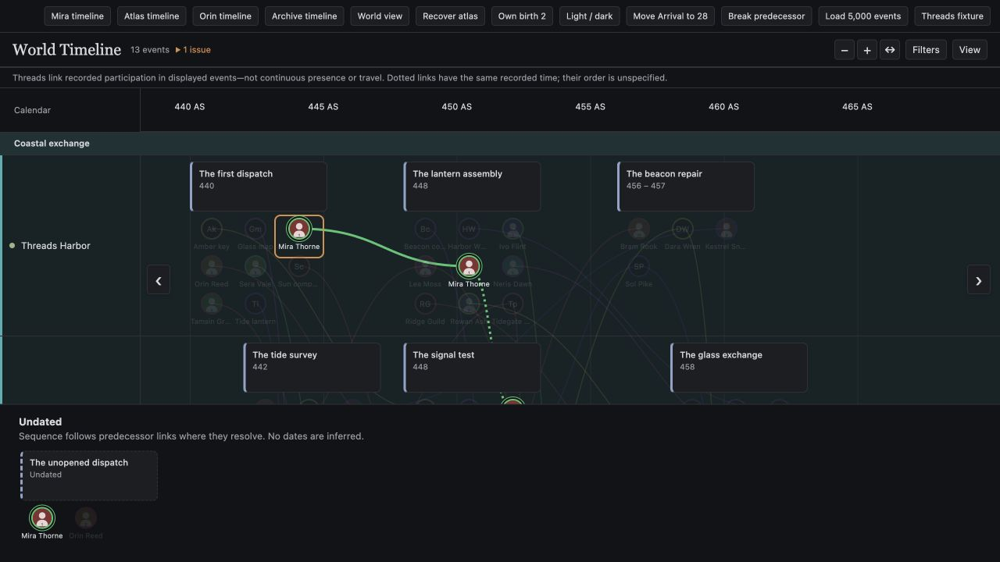

<p align="center"></p>

# Marginalia

Build your world, write your scripts, and follow their threads inside Obsidian.

**Version 0.5.0 — prepared for release, not yet published in Community plugins.** MIT licensed. App pages and script tools support desktop/mobile; Timelines, local AI and PDF export are desktop-only. See [platform limits](#requirements-and-platforms).



## Features

- **A workspace for your notes.** Home, Canon, Brainstorms and Projects; World/Storyboard vault types; configurable entry types, folders and templates; optional app light/dark styling. Use New Entry from app pages. Original entries remain Markdown files in your vault.
- **Timelines for your world.** Ordinary Calendar notes, custom calendars with signed years, event dates/spans, colored location groups, drag ordering, horizontal trackpad panning, multi-entry Canon filter chips, entry histories and state/location snapshots with source evidence. Undated events remain separate; missing information stays unknown.
- **Threads.** An optional timeline view connects participants across event and location lanes, including toward offscreen occurrences. Use local entry images or initials. Single-click to highlight; double-click for an entry timeline. Connections describe recorded participation, not continuous presence or travel.
- **Script Studio.** A project/grouping outline beside the native editor, with pages/panels, guarded script reordering, slash shortcuts and character suggestions. Optional focused writing, countdown, daily net-word goals and session history. Read projects continuously and compile selected scripts to PDF on desktop.
- **A local Librarian.** Ask with original-source context; review Entry Enhancement, Entry Expansion, Entry Development or Vault Review. Accept source changes individually. Development conversations default to Brainstorms/Development. AI-only expansions and reports are hidden under `.marginalia` and open through Library.
- **Independent modules.** Enable the tools you want. Ollama is only needed for the Librarian.

## Install

Install using the ZIP download or the raw assets from [GitHub releases](https://github.com/dcburtonwrites/Marginalia_plugin/releases). No Community directory listing is required.

For the ZIP download:

1. Download the prepared `marginalia-0.5.0.zip` release package and unzip it.
2. Copy its `marginalia` folder into your vault's configuration directory under `plugins` (normally `.obsidian/plugins/marginalia`). It contains `main.js`, `manifest.json` and `styles.css`.
3. Reload Obsidian, then enable Marginalia under Community plugins.
4. Open **Settings → Marginalia**, choose World or Storyboard, configure vault routes/templates, and enable the modules you want.

Alternatively, download `main.js`, `manifest.json` and `styles.css` individually from a GitHub release’s Assets and place them in the same `marginalia` plugin folder. Use release assets, not GitHub’s Source code ZIP.

Back up your vault before reorganizing an existing project. When updating, replace only the three plugin files; preserve your existing `data.json`.

## Explore the Greek Demo

The website offers `marginalia-greek-demo-0.5.0.zip`: a complete separate vault with 72 notes, a linked cast, two calendars, 20 timeline events, participant Threads and a sample comic project. Five walkthroughs are pinned on Home. Unzip and choose **Open folder as vault** in Obsidian, review the trust prompt and enable Marginalia; reload if needed, then use Open Home. Do not merge its `.obsidian` folder into your existing vault. Ollama/models are optional and not bundled. See [demo documentation](demo/greek/README.md).

## Getting started

Use **Marginalia: Open Home** to reach the app pages. Configure Canon types and templates with **Theme → Configure vault…**. New Entry creates a Brainstorm, Canon entry or Project using your selected destination/template. Optional Bases-backed Storyboard Project Register needs Obsidian 1.10+ with Bases enabled; the built-in register does not.

### Timelines and Threads

In a desktop World vault, enable **Settings → Marginalia → Timelines**. Enabling creates a default Calendar note if one is missing. Use the timeline ribbon or **Open World Timeline**.

Add Calendar, Date (or Start/End), Locations and participant links to your event notes. Calendar is a **plain note name/path**, not a wikilink. For example, with a Calendar note named Calendar:

```yaml
Type: Event
Calendar: Calendar
Date: "440"
Locations:
  - "[[Harbor]]"
Participants:
  - "[[Mira Thorne]]"
```

Use View to choose/reorder lanes, create colored groups, toggle Threads/images, and inspect a Snapshot at time. Filters suggest Canon entries and keep multiple selections as removable chips. Threads use the configurable icon property (default `icon`), for example `icon: "[[Assets/Mira.png]]"`; missing images use initials. Click a marker/line to pin a highlight, blank chart space or Escape to clear, and double-click to open history. Ctrl/Command+Enter opens a focused marker's history.

Calendars allow year zero and negative/positive years. Lower-precision dates resolve to the beginning of that date internally. Entry-owned lifecycle dates override corresponding event dates; status changes happen at span end. Timeline diagnostics are separate from AI reasoning. Structured timeline editing is deferred; use ordinary note Properties.

### Scripts

The M ribbon opens Script Studio. Choose a project/grouping; arrows disclose, names navigate. Drag scripts to reorder their predecessor chain. Choose a script template location in settings; New Script or a folder's **Create a New Script** creates a copy without executing template code.

Type a shortcut alone on a script line, then Enter: `/P` page, `/p` panel, `/d` dialogue, `/t` title/display, `/c` or `/cn` note; `/ct`, `/cw`, `/cd`, `/cs`, `/ce` create tip, warning, danger, success and example callouts. Conversion has its own Undo. Desktop dialogue uses an inline character dropdown; mobile uses a searchable dialog. Ordinary notes, code and frontmatter keep native Enter behavior.

View options controls folding. Settings offers focused writing, a configurable countdown, daily goals (All projects, Current project, Full vault) and optional session history. Word counts track net local editor changes while the plugin is running, without backfilling prior writing. Reload restores the timer paused. Compile PDF lets desktop users choose scripts, content, title page and output preferences; mobile offers script preview.

### Librarian

Install [Ollama](https://ollama.com/download) separately on desktop and install a model suited to your computer. Enable Librarian in settings, connect to the local server (default `http://127.0.0.1:11434`) and choose an installed model. The lantern, right sidebar and Open Librarian command open the tool. Follow the active note or pin its context.

Ask is conversational. Review starts with four actions and hides alternatives after selection. Library browses expansions/reports and resumes saved development. Development is an adaptive conversation, followed by individually recommended insertions, deletions or changes. Vault Review is a source-linked checklist with timeline context. Read the sources and review suggestions before accepting edits; model output can be wrong.

## Privacy, files and external services

- Original notes remain the source of truth. Source changes require explicit acceptance; supported native edits are undoable.
- Librarian sends bounded note/context material to your locally configured Ollama server. Connections are loopback-only. No cloud fallback, automatic model download, analytics or telemetry.
- Generated expansions: `.marginalia/expanded/<entry path>.md`; AI-only Vault Reviews: `.marginalia/reviews`. These stay outside canonical evidence and open through Library.
- Author-written Development defaults to Brainstorms/Development; settings can change its vault or hidden save location. Plugin settings use Obsidian's plugin data storage. Verify your sync provider's treatment of hidden folders and plugin data separately.
- Desktop PDF export uses a native save dialog and writes the chosen output file outside the vault if selected. Its temporary file is cleaned up.
- The optional website PayPal button opens the owner's donation page. The website request form uses FormSubmit to send explicitly submitted messages to deondoesmore@gmail.com; it is separate from the plugin. Neither service receives vault data from the plugin.
- No plugin account, subscription or payment is required. Ollama models have their own licenses and hardware requirements.

## Requirements and platforms

Declared minimum: **Obsidian 1.8.7**; optional Bases integration: **1.10+**. Native desktop verification used **1.14.5**; dedicated minimum-version acceptance remains outstanding before Community submission.

| Feature | Desktop | Mobile |
| --- | --- | --- |
| App pages, native scripts, writing tools | Available | Available; device acceptance continues |
| Timelines and Threads | World vaults | Unavailable |
| Local Librarian | Requires local Ollama/model | Unavailable |
| Compilation | PDF preview/export | Script preview |

Automated mobile loading and phone/tablet browser profiles pass; some native iPhone checks pass. Physical Android, remaining iOS software-keyboard/IME interactions, Windows/Linux PDF export and hidden-file synchronization need wider verification. See [device evidence](docs/verification/device-release-2026-10-25.md) and [roadmap](docs/ROADMAP.md). A prepared package is not Community approval.

## Build, verify and release

Development requires Node 22.18+. Release ZIP preparation also uses Python 3; these are not separate plugin runtime requirements.

```sh
npm ci
npm test
npm run release:prepare
node scripts/verify-mobile-load.mjs
npm run website:check
```

`npm run package` produces the three plugin files in `dist/marginalia`. `release:prepare` adds raw release assets, a manual-install ZIP and SHA-256 checksums under `dist/release-0.5.0`, plus the unpublished static-site ZIP. It never copies to a vault, creates a tag or publishes anything. See [release/submission guide](RELEASE.md), [release notes](RELEASE-NOTES.md), and [website preview/hosting instructions](website/README.md).

For fictional shared-component previews, run `npm run preview:build` and serve `.preview`: index.html (Librarian), scripts.html, workspace.html, timeline.html and world-timeline.html. No real vault is needed. Tests cover pure logic and the simulated Obsidian host; real-device limits remain above.

## Support

[Donate through PayPal](https://www.paypal.com/donate/?hosted_button_id=TAU2X5WLXWF8C), or send requests to [deondoesmore@gmail.com](mailto:deondoesmore@gmail.com). Donations are optional. Licensed under [MIT](LICENSE).

Website launch (D-0076): [Marginalia](https://karma-voyage-a7mb.here.now/) is now published through the owner’s here.now account. Plugin and Greek Demo downloads match the current 0.5.0 release. The private request receiver is tested; FormSubmit activation and full email/webhook verification are pending because the provider blocked automated access. See [launch verification](docs/verification/request-log-launch-2026-11-02.md).

Final launch acceptance: https://karma-voyage-a7mb.here.now/ is deployed. The activated FormSubmit alias and Google receiver version 2 delivered a real test to email and one matching private Sheet row; earlier pending status is superseded. See docs/verification/request-log-launch-2026-11-02.md.
